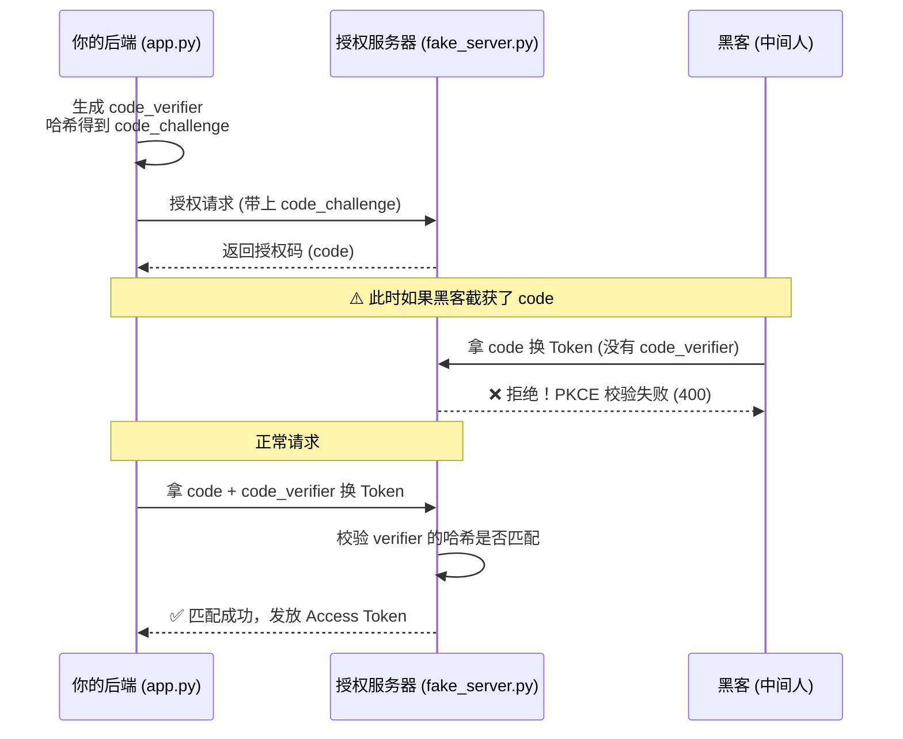

# OAuth 2.0 Authorization Code + PKCE 本地演示

这是一个极简的本地实战 Demo，用于演示和学习 **OAuth 2.0 授权码模式（Authorization Code Flow）** 结合 **PKCE（Proof Key for Code Exchange）** 的完整运行机制。

本项目不需要注册任何真实的第三方平台（如 Amazon Developer），通过本地的一个模拟授权服务器（Fake Server），让你完整体验从“发起授权”到“换取 Token”的全过程。

## 📂 项目结构

*   `app.py`：你的业务后端（模拟你的 Web 应用），监听在 `5005` 端口。
*   `fake_server.py`：模拟的第三方授权服务器（模拟 Amazon LwA 服务），监听在 `5001` 端口。

## 🛠️ 环境准备

本项目使用 Python + Flask 编写。请确保你的电脑安装了 Python 3。

```bash
# 1. 克隆或创建项目目录
mkdir oauth-pkce-demo
cd oauth-pkce-demo

# 2. 创建并激活虚拟环境
python3 -m venv venv
source venv/bin/activate  # Windows 用户请使用: venv\Scripts\activate

# 3. 安装依赖
pip install flask requests
```
##  🚀 如何运行
你需要打开 两个独立的终端窗口 来运行这两个服务。

终端 1：启动模拟授权服务器 (Fake Server)
```bash
source venv/bin/activate
python fake_server.py
# 看到 Running on http://127.0.0.1:5001 即成功
```
终端 2：启动你的业务后端 (Web App)

```bash
source venv/bin/activate
python app.py
# 看到 Running on http://127.0.0.1:5005 即成功
(注：Mac 用户请注意避开 5000 端口，以免被系统的 AirPlay 接收器拦截。)
```

## 🎬 演示流程
打开浏览器（强烈建议使用无痕模式，避免旧 Cookie 干扰）。

1. 访问你的业务后端：http://localhost:5005

2. 点击页面上的 “点击这里去第三方授权登录” 链接。

3. 浏览器会瞬间跳转到 5001（模拟第三方），然后立刻跳回 5005/callback。

4. 最终页面会显示：登录成功！ 并且附带一个伪造的 Access Token

## 🔍 核心技术点解析：PKCE 为何安全？

在这个 Demo 中，我们在标准的 OAuth 2.0 授权码流程基础上，加入了 **PKCE (Proof Key for Code Exchange)** 扩展。它通过“哈希挑战”机制，彻底阻断了授权码被拦截的风险。

### 1. 核心四步曲

*   **① 本地生成暗号 (Client-side)**：
    `app.py` 在发起请求前，生成一个高强度的随机字符串 `code_verifier`（保存于后端 Session，绝不外传），并计算它的 SHA-256 哈希值，作为 `code_challenge`。
*   **② 传递挑战 (To Auth Server)**：
    浏览器跳转到第三方授权服务器时，URL 中携带这个哈希后的 `code_challenge`。
*   **③ 验证真身 (To Token Endpoint)**：
    当用户授权完毕，前端拿着 `code` 去换取 Token 时，**必须带上最开始生成的那个原始暗号 `code_verifier`**。
*   **④ 服务器校验 (Auth Server)**：
    Fake Server 收到请求后，对客户端传来的 `code_verifier` 现场做一次哈希计算，看结果是否等于第一步存下的 `code_challenge`。如果匹配，才发放 Token。

### 2. 时序图直观展示

